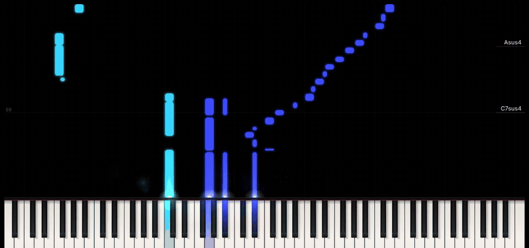
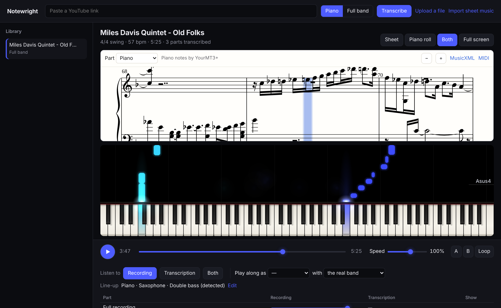

# Notewright

Paste a YouTube link and get the music back as sheet music and a falling-notes piano roll. Play the original next to the transcription at any speed, or mute your own instrument and play along with the rest of the band.

Everything runs on your own computer. Notewright uses no accounts, no cloud service and no subscription.



## What it does



- **Piano mode** transcribes a piano recording: every note, how hard it was played, and the sustain pedal.
- **Full band mode** separates the instruments, recognises which ones actually play, and transcribes each one. You see your real line-up (for example piano, saxophone, trumpet, double bass and drums), not a fixed list. If the line-up is wrong, tick the right instruments and the parts are rebuilt.
- **Sheet music** in the right time signature (2/4, 3/4, 4/4, 6/8, 9/8, 12/8), with bar lines on the real downbeats, a key signature, and the piano split across two staves by hand. Swing is written in plain eighth notes marked "Swing", the way jazz charts are, and real triplets stay triplets.
- **Piano roll**, Synthesia style, with each instrument in its own colour.
- **Sampled instruments** for the transcription: a Steinway grand, a recorded tenor sax, a pizzicato double bass and an acoustic drum kit (from the CC0 [Versilian Community Sample Library](https://vis.versilstudios.com/vcsl.html)), in a small room.
- **Playback** of the original, the separated parts and the transcription (played on sampled instruments), each with its own volume. The player measures the delay between the recording and the notes in your browser and corrects for it, so they stay together.
- **Speed** from 25% to 150% without changing pitch, plus A–B looping for practice. Below 95%, the recording and its parts are re-rendered with [Signalsmith Stretch](https://github.com/Signalsmith-Audio/signalsmith-stretch) and swapped in when ready, so slow practice sounds clean rather than smeared.
- **Play along**: mute your instrument and keep either the real band (the separated recording) or the transcribed band. A song transcribed in piano mode can be separated later with one click, without downloading it again.
- **More or fewer notes**: if quiet notes are missing, such as comping chords under a solo, move the slider above the sheet music. Notewright then reads that part again from the saved model output, which takes seconds.
- **Chords** named from the transcription, shown in the piano roll and above the sheet music. Where the tune repeats chorus after chorus, each chord is named from the same place in every chorus together, which on a Ron Carter Autumn Leaves more than doubled how often the chord root matched the standard changes (24% to 54% of bars).
- **Full screen** (press F): just the sheet or the piano roll, with the player controls in a bar below.
- **Import sheet music**: snip piano music from a web page or PDF and press ⌘V (Ctrl+V) in Notewright, or use "Import sheet music" or drop files on the page. Pictures in any common format (PNG, JPEG, WebP, HEIC, TIFF…), PDFs, MusicXML and MIDI all work, and several snips at once become one piece, in order. The notes are read with [homr](https://github.com/liebharc/homr) optical music recognition and stored as MusicXML, so you can practise them with the piano roll, the cursor, slow tempo and loops. A lead sheet exported as PDF from notation software (MuseScore, Dorico, Sibelius, iReal Pro…) keeps its chord symbols: they appear above the melody and in the piano roll, and a Chords part plays them (root low, the other chord tones in the middle) so you hear the harmony. Chord symbols in pictures and scans are not read yet. The first import downloads homr's models (a few hundred MB).
- **Export** to MusicXML (opens in MuseScore, Sibelius, Finale or Dorico) and to MIDI.

## Requirements

- A Mac (Apple Silicon is fastest; Intel works) or Linux. Windows isn't supported yet.
- About 6 GB of free disk space (9 GB with the YourMT3+ add-on), and 8 GB of memory.
- An internet connection for the install, for YouTube links, and the first time each instrument sound plays.

## Install

On a Mac or Linux, paste this into Terminal:

```bash
curl -fsSL https://raw.githubusercontent.com/anderskhv/notewright/main/install.sh | bash
```

It needs no Homebrew and no administrator password. It installs Notewright into `~/notewright` with its own Python, downloads the models (about 650 MB), offers the YourMT3+ add-on, and puts **Notewright** on your Desktop. Double-click that to start: it updates Notewright and opens it in your browser. Running the command again also updates. The first install downloads a few GB and takes 10 to 20 minutes, depending on your connection.

<details>
<summary>Install by hand instead</summary>

You need Python 3.11–3.13, [ffmpeg](https://ffmpeg.org), and a JavaScript runtime for YouTube downloads: [Node.js](https://nodejs.org) or [Deno](https://deno.com). On macOS with [Homebrew](https://brew.sh):

```bash
brew install python@3.13 ffmpeg node
```

Then create the environment with `python3.13`. On a Mac, plain `python3` is Apple's older Python 3.9, which can't install the requirements.

```bash
git clone https://github.com/anderskhv/notewright.git
cd notewright
python3.13 -m venv .venv
source .venv/bin/activate
pip install --upgrade pip
pip install -r requirements.txt
python -m notewright.fetch
```

</details>

## Run

Double-click **Notewright** on your Desktop, or in Terminal:

```bash
source .venv/bin/activate
python -m notewright
```

This opens http://127.0.0.1:8765 in your browser. The models live in `~/.cache` (the installer or `python -m notewright.fetch` downloads them; otherwise the first song does). After that, transcription works offline. Instrument sounds for playback load from the web the first time they are used.

If YouTube answers "Sign in to confirm you're not a bot", let yt-dlp use your browser's YouTube sign-in. Name your browser (`chrome`, `safari`, `firefox`, `edge` or `brave`):

```bash
NOTEWRIGHT_COOKIES_FROM_BROWSER=chrome python -m notewright
```

Transcriptions are kept in `data/` next to the code. Set `NOTEWRIGHT_DATA` to keep them somewhere else.

### Speed

Notewright runs the models on the fastest hardware it finds: an NVIDIA GPU, the GPU in an Apple Silicon Mac, or else the CPU. The models and their weights are the same everywhere, so the notes don't change, only the speed. If a step can't run on the GPU, it runs on the CPU instead and the terminal says so. To force the CPU, start it with `NOTEWRIGHT_DEVICE=cpu`.

With a GPU, the YourMT3+ add-on and 16 GB of memory or more, instrument separation (on the GPU) and YourMT3+ (on the CPU) run at the same time.

After each song, the terminal shows how long every step took. To check that two transcriptions of the same song agree note by note (for example before and after a change of hardware), run `python -m notewright.compare "Song title"`.

### Better piano in band recordings (optional add-on)

The built-in piano model was trained on solo concert piano, and it misses and invents notes when a band plays around the piano. The optional [YourMT3+](https://github.com/mimbres/YourMT3) add-on was trained on band recordings. On a test ballad with known notes (piano comping under a tenor sax melody, with bass), the full-band piano part improves like this:

| | Correct notes | Notes found |
| --- | --- | --- |
| Built-in piano model | 56% | 83% |
| With the YourMT3+ add-on | 81% | 88% |

Saxophone, bass and drums stay with Notewright's own pipeline, which did better on them. To install the add-on (Python 3.12 needed; on a Mac `brew install python@3.12`):

```bash
addons/yourmt3/install.sh
```

It adds about 3 GB and roughly 1.5 times the song's length to each full-band transcription. It is downloaded from its authors and runs as a separate program; see [addons/yourmt3/README.md](addons/yourmt3/README.md) for its licence.

## How it works

| Step | Model or method |
| --- | --- |
| Download | [yt-dlp](https://github.com/yt-dlp/yt-dlp) |
| Separate instruments | [Demucs](https://github.com/facebookresearch/demucs) `htdemucs_6s` (MIT) |
| Recognise instruments, regroup parts | [PANNs](https://github.com/qiuqiangkong/panns_inference) sound-event model, Kong et al. 2020 (MIT), plus note-content matching between parts |
| Horns (sax, trumpet, trombone) | One melodic line from the horn part, divided between the horns by register and phrase |
| Piano and horns together | The piano is transcribed twice, from its own part and from piano and horn parts together with the horn line filtered out (a loud horn hides quiet comping), and the notes are combined; then each piano note's harmonics are filtered out of the horn audio (score-informed separation), and notes that start with a piano chord and die away are dropped from the horn line |
| Piano, guitar, other | [High-resolution piano transcription](https://github.com/qiuqiangkong/piano_transcription_inference), Kong et al. 2021 (MIT) |
| Bass | With the YourMT3+ add-on: its bass notes, filled in by pitch tracking wherever it filed a note under another instrument. Every note start is moved to the pluck in the bass part, and the piano's notes are filtered out of the bass part first |
| Vocal melody (and bass without the add-on) | Probabilistic YIN pitch tracking ([librosa](https://librosa.org)) plus onset detection |
| Drums | Onset detection plus a three-band energy split into kick, snare and hi-hat |
| Beats, downbeats, meter | [Beat This!](https://github.com/CPJKU/beat_this), Foscarin et al. 2024 (MIT), counted at one tempo level through the song (no switches to half or double time), with the bar lines kept on its downbeats |
| Sheet music | Per-beat rhythm quantisation (straight or triplet), hand splitting and [music21](https://github.com/cuthbertLab/music21) (BSD-3-Clause) |
| Reading sheet music from pictures | [homr](https://github.com/liebharc/homr) (AGPL-3.0, run as a separate program) and [pypdfium2](https://github.com/pypdfium2-team/pypdfium2) for PDF pages |
| Rendering and sound | [OpenSheetMusicDisplay](https://opensheetmusicdisplay.org) (BSD-3-Clause) and [smplr](https://github.com/danigb/smplr) (MIT) |

The sheet music is written on the beat grid detected in the recording, so tempo changes and rubato don't push the bar lines out of place. The player uses the same grid to move the cursor.

## Tips

- **Piano with a band** (jazz, pop): use full band mode, or press "Separate instruments" afterwards. The piano model then hears the piano on its own, so it picks up much more of the quiet voicings than it does from the full mix.

## Limits

- **Piano** is the strongest part: the model was trained on concert piano recordings.
- **Horns** share one separated recording part: no open-source separator splits a sax from a trumpet. Their note tracks are separate, divided by register (trumpet sits above tenor sax) and smoothed over whole solos. In unison passages the line goes to one of them.
- **Instrument recognition** is a suggestion. Old or dull recordings can hide an instrument, so check the line-up and correct it.
- **Guitar and "other"** reuse the piano model. That works reasonably for plucked and struck instruments and less well for distorted guitar or pads.
- **Bass and vocals** are tracked as single melodic lines. Chords sung by a choir become one line.
- **Drums** come out as kick, snare and hi-hat only.
- **Sheet music** is a starting point, not finished engraving. It uses one voice per staff, and it does not detect meter changes in the middle of a song.
- **Imported sheet music** plays at 100 bpm unless the page has a metronome mark; set the speed with the slider. Recognition can misread a note, a tie or a rest in dense or handwritten music, so compare with the picture before you memorise it.
- **YouTube downloads** are for music you have the right to use.

## Development

```bash
python -m pytest
```

To check a change against numbers rather than by ear, transcribe the same songs before and after and compare `python -m notewright.scorecard "Song title"`: bass notes missed and without a pluck, bass range, piano left in the bass part, and tempo steadiness.

Tests live in `tests/`; `pytest.ini` keeps add-on code out of the run.

The web player is plain JavaScript modules in `web/`, with no build step. `window.notewright.player` is exposed for poking at playback from the browser console.

## License

MIT. Libraries and models keep their own licenses, listed above and in `web/vendor/README.md`. `notewright/audioset_labels.csv` is Google's AudioSet label list (CC BY 4.0).
